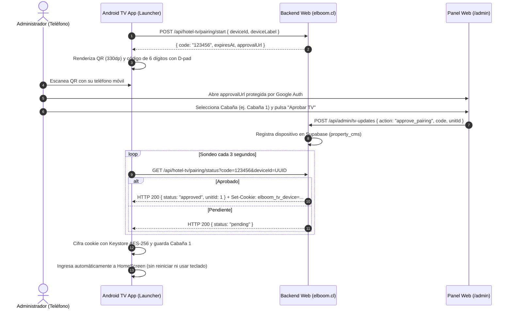

# Documentación Oficial: Sistema Android TV Alojamientos El Boom · Licán Ray

Este documento describe en detalle la arquitectura técnica, seguridad, flujo de emparejamiento nativo por QR y el catálogo exhaustivo de endpoints de backend en `https://elboom.cl` que utiliza la aplicación Android TV (`cl.elboomlicanray.tvlauncher`).

---

## 1. Arquitectura y Filosofía de Seguridad

### Principios Fundamentales
1. **Cero PINs o Tokens Manuales**: La aplicación nunca solicita ingresar contraseñas, PINs ni tokens con el control remoto.
2. **Cero Tokens Compartidos**: Se eliminaron por completo las credenciales universales compartidas (`HOTEL_TV_UNIFIED_TOKEN`). Cada televisor posee su propia identidad criptográfica individual.
3. **Identificador de Dispositivo Anónimo y Estable**:
   - Generado de forma local mediante `UUID.randomUUID().toString()`.
   - No utiliza IMEI, dirección MAC, número de serie de hardware ni datos personales sensibles.
   - Almacenado de forma persistente y cifrado en almacenamiento local.
4. **Cifrado de Hardware con Android Keystore**:
   - La cookie de sesión (`elboom_tv_device`) emitida tras la aprobación del administrador se cifra utilizando una llave simétrica **AES-256-GCM** generada y custodiada por el **Android Keystore** del televisor.
   - La cookie nunca se imprime en Logcat, nunca se transmite en URLs y nunca se expone en reportes de fallas.
5. **Aislamiento Estricto por Cabaña**:
   - Una TV autorizada para la Cabaña 1 jamás puede consultar ni modificar reservas de la Cabaña 2.
6. **Revocación Inmediata y Limpieza de Huésped (Zero Leak)**:
   - Si el administrador presiona **Revocar** en el panel, la siguiente petición del TV recibe `HTTP 401 Unauthorized`.
   - La app destruye inmediatamente la cookie de Keystore, borra la información de la estadía en memoria y disco, y transiciona a la pantalla de emparejamiento.

---

## 2. Flujo de Emparejamiento Nativo por Código QR



---

## 3. Catálogo Detallado de Consultas al Backend (`elboom.cl`)

### 3.1. Emparejamiento y Autenticación de Dispositivos

#### `POST /api/hotel-tv/pairing/start`
- **Propósito**: Inicia el proceso de emparejamiento para un televisor nuevo, reinstalado o revocado.
- **Acceso**: Público (Rate limit estricto por IP y dispositivo).
- **Payload Request**:
  ```json
  {
    "deviceId": "c8a41b2e-7f6d-4912-a1b3-8c4d2e5f6a7b",
    "deviceLabel": "El Boom TV · Google AOSP TV on x86 · v1.0.52"
  }
  ```
- **Respuesta Exitosa (HTTP 200)**:
  ```json
  {
    "success": true,
    "code": "231230",
    "expiresAt": 1731913093000,
    "deviceId": "c8a41b2e-7f6d-4912-a1b3-8c4d2e5f6a7b",
    "approvalUrl": "https://elboom.cl/admin?tab=tv_updates&tv_pair=231230"
  }
  ```

#### `GET /api/hotel-tv/pairing/status?code={CODE}&deviceId={UUID}`
- **Propósito**: Sondeo periódico del televisor cada 3 segundos durante los 10 minutos de vigencia del código.
- **Acceso**: Público (Rate limit: 250 peticiones / 10 minutos).
- **Respuesta Pendiente**:
  ```json
  { "success": true, "status": "pending" }
  ```
- **Respuesta Aprobada**:
  - Encabezado: `Set-Cookie: elboom_tv_device=<JWT_FIRMADO>; Path=/; Max-Age=7776000; HttpOnly; Secure; SameSite=Lax`
  ```json
  { "success": true, "status": "approved", "unitId": 1 }
  ```

---

### 3.2. Operación de Huésped y Cabaña

#### `GET /api/hotel-tv?unit={unitId}`
- **Propósito**: Obtiene los datos de la estadía actual y próxima de la cabaña, estado de aseo y clima.
- **Seguridad**: Cookie de sesión `elboom_tv_device` obligatoria (o sesión admin).
- **Privacidad**:
  - Solo primer nombre del huésped (ej. "Carlos"), sin apellidos completos.
  - Cero números de teléfono, correos electrónicos o RUT/pasaporte.
  - Cero información financiera o montos pagados.
- **Respuesta (HTTP 200)**:
  ```json
  {
    "success": true,
    "unit": { "id": 1, "name": "Cabaña N°1" },
    "stay": {
      "guestName": "Carlos",
      "checkIn": "2026-11-18",
      "checkOut": "2026-11-21",
      "nights": 3,
      "pax": 4,
      "isCheckInDay": true,
      "isCheckOutDay": false
    },
    "cleaning": {
      "isReady": true,
      "lastCleanedAt": "2026-11-18T10:00:00Z"
    }
  }
  ```
- **Manejo de Errores**:
  - `HTTP 401 / 403`: Si el dispositivo fue revocado o expiró, la TV elimina la cookie y vuelve al emparejamiento.

#### `POST /api/hotel-tv/cleaning/ready`
- **Propósito**: Permite al huésped o mucama notificar que la cabaña fue desocupada o aseada.
- **Seguridad**: Cookie `elboom_tv_device` vinculada exactamente a esa cabaña.
- **Payload**:
  ```json
  { "unitId": 1 }
  ```

#### `POST /api/hotel-tv/send-attraction`
- **Propósito**: Envía la información de un punto de interés o coordenadas GPS de la guía turística al teléfono del huésped por WhatsApp.
- **Seguridad**: Cookie `elboom_tv_device` asociada a la cabaña con reserva activa.

---

### 3.3. Contenidos Informativos y Multimedia

#### `GET /api/accommodations`
- **Propósito**: Catálogo completo de cabañas de Alojamientos El Boom con fotos de alta resolución, distribución de camas, comodidades y capacidad.
- **Caché**: HTTP 304 Not Modified con ETag / If-None-Match para no consumir ancho de banda en la TV.

#### `GET /api/tourist-guide`
- **Propósito**: Guía interactiva de atractivos de Licán Ray y la Región de los Ríos / Araucanía (termas, playas, volcanes, parques nacionales y gastronomía).

#### `GET /api/property`
- **Propósito**: Información general del complejo: horarios de recepción, normas de convivencia, uso de tinajas calientes, clave Wi-Fi y contactos de emergencia.

---

### 3.4. Actualizaciones de Flota en Vivo (OTA)

#### `GET /api/tv/update`
- **Propósito**: Contrato estricto consultado periódicamente por el `OtaUpdateManager` del televisor.
- **Contrato JSON**:
  ```json
  {
    "versionCode": 52,
    "versionName": "1.0.52",
    "downloadUrl": "https://github.com/K1OX1/app-tv-elboom/releases/download/v1.0.52/app-release.apk",
    "apkUrl": "https://github.com/K1OX1/app-tv-elboom/releases/download/v1.0.52/app-release.apk",
    "changelog": "v1.0.52: Emparejamiento nativo con QR y cifrado Keystore...",
    "sha256": "1AEF4F8366EDF3B21D9EE2DE02BD9229CA2B419181AAFAA3D315B60F5B009A2C"
  }
  ```

#### `POST /api/admin/tv-updates`
- **Propósito**: Gestión administrativa de flota desde el panel de control web (`/admin?tab=tv_updates`).
- **Acciones Disponibles**:
  - `approve_pairing`: Aprueba un código de 6 dígitos asignándolo a una cabaña.
  - `revoke_device`: Revoca inmediatamente un televisor por su `deviceHash`.
  - `change_cabin`: Reasigna un televisor existente a otra cabaña sin re-emparejar.
  - `sync_github`: Fuerza la purga de caché y sincronización en tiempo real contra GitHub Releases.

---

## 4. Estructura de Clases en Android (`app/src/main/java`)

```
cl.elboomlicanray.tvlauncher/
├── data/
│   ├── repository/
│   │   ├── HotelTvRepository.kt         # Peticiones con cookie inyectada y control de 401
│   │   └── TvPairingRepository.kt       # API cliente para start y status de emparejamiento
│   └── security/
│       └── TvDeviceSecurityManager.kt   # Android Keystore AES-256-GCM y UUIDv4 anónimo
├── domain/
│   └── model/
│       └── TvPairingModels.kt           # Modelos de estado (Loading, Waiting, Approved, etc.)
└── presentation/
    ├── home/
    │   ├── HomeScreen.kt                # Vista principal (10 pies) y modal de pairing
    │   ├── HomeViewModel.kt             # Orquestación reactiva y manejo de unpair
    │   └── AdminSettingsDialog.kt       # Diálogo con acceso a desvincular/emparejar
    └── pairing/
        ├── TvPairingScreen.kt           # UI Compose nativa con QR 330dp y contador 10m
        └── TvPairingViewModel.kt        # State machine y sondeo periódico cada 3s
```
